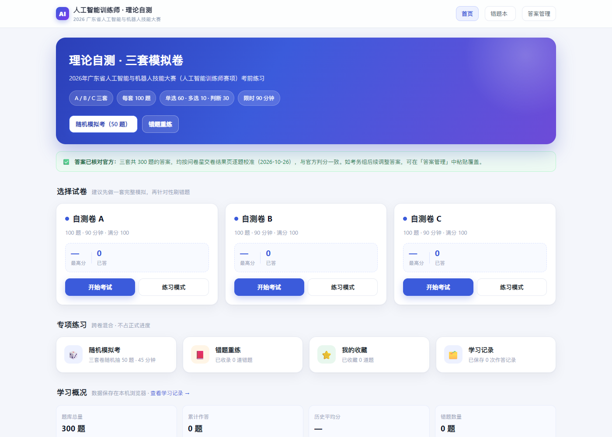
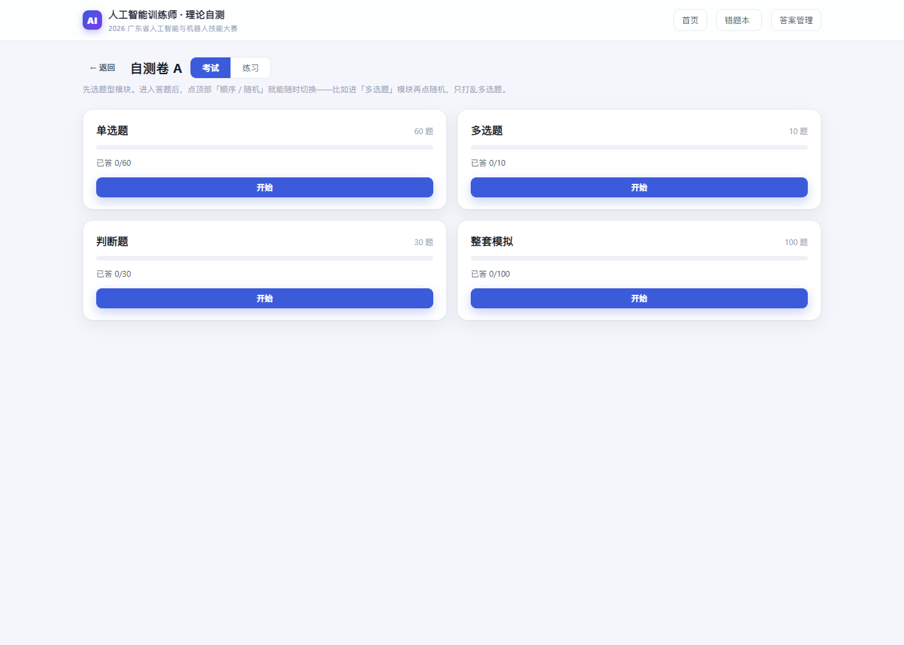
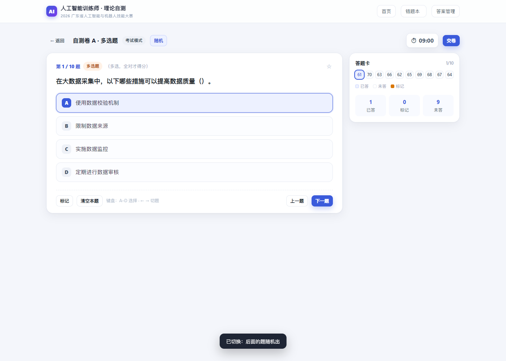
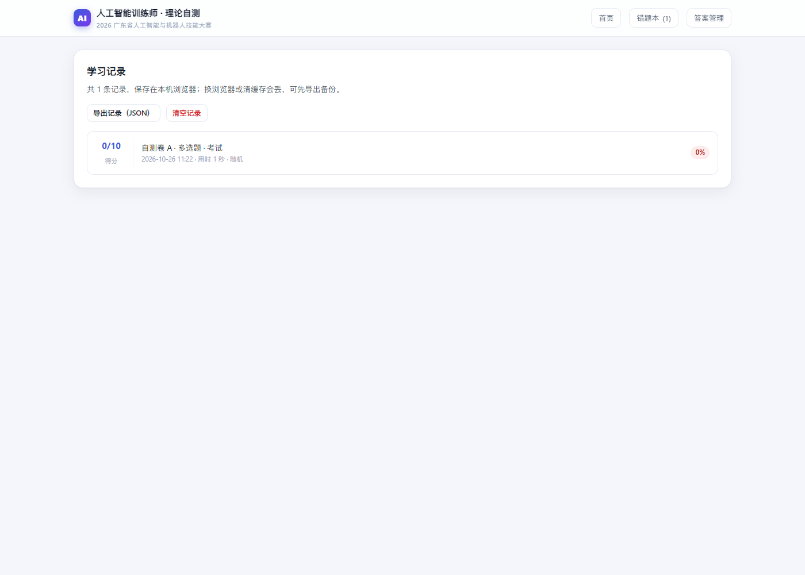

# 人工智能训练师 · 理论自测练习

2026 年广东省人工智能与机器人技能大赛（人工智能训练师赛项）考前练习网页。
把问卷星公布的三套线上自测卷整理成一个**离线可用、自动判分**的单页应用，打开就能刷题。

> 三套卷各 100 题（单选 60、多选 10、判断 30），共 300 题，答案已按问卷星官方判分结果逐题核对。

## 在线使用

启用 GitHub Pages 后访问：<https://2252268083.github.io/fize_ai_shengchengshi/>

也可以直接把仓库里的 `index.html` 下载到本地，双击用 Chrome / Edge 打开（无需联网）。

## 功能

- **题型模块**：每套卷先分成 单选题 60 / 多选题 10 / 判断题 30，另有整套模拟 100，各自独立进度与成绩。
- **考试模式**：整套 90 分钟（单选 54、多选 9、判断 27，按题量比例），可标记、跳题，交卷后逐题显示对错。
- **练习模式**：选完立即判对错；多选题点「确认作答」后锁定。
- **随时换序**：答题页顶部「顺序 / 随机」按钮随时切换，只重排当前模块后面的题——
  例如进「多选题」再点随机，就只打乱这 10 道多选题；已答进度不受影响。
- **答题卡**：已答 / 未答 / 标记一目了然，点题号直接跳转。
- **错题本**：答错自动收录，答对自动移出，可一键重练。
- **收藏**、**随机模拟考（三套混抽 50 题）**。
- **学习记录**：每次交卷自动保存得分、用时、题型，支持导出 JSON。
- **断点续做**：进度存在浏览器本地，关掉再开会有「继续：考试 · 随机 · 32/70」按钮。
- 适配手机，支持键盘 A–D 选项、← → 切题。

## 截图

| 首页 | 题型模块 |
| --- | --- |
|  |  |

| 答题页（多选题模块） | 学习记录 |
| --- | --- |
|  |  |

## 目录结构

```
index.html          单文件版（样式、脚本、题库全部内联，双击即用）
src/                文件夹版源码
  index.html
  assets/app.css
  assets/app.js
  data/questions.js  题库（题干 + 选项）
  data/answers.js    官方答案
docs/
  使用说明.txt
  screenshots/       界面截图
legacy/index.html   旧版「理论题库练习系统」（docx 导入版），保留备查
README.md           项目说明
交接文档.md          开发交接文档（数据结构、构建发布、更新记录）
```

## 答案说明

问卷星原卷交卷后才显示答案。本项目于 2026-10-26 分别提交三套卷，
从交卷结果页逐题抓取「正确答案」，与官方判分完全一致（三套答满均为 100 分）。

如果考务组后续调整答案，可在页面「答案管理」中按
`题号 答案`（如 `1 D`、`12 ACD`）批量粘贴覆盖，成绩会立即重算。

## 说明

- 题库与答案仅用于赛前练习，版权归原出题方所有。
- 作答记录保存在浏览器 localStorage，换浏览器或清缓存会丢失，重要记录可导出备份。
